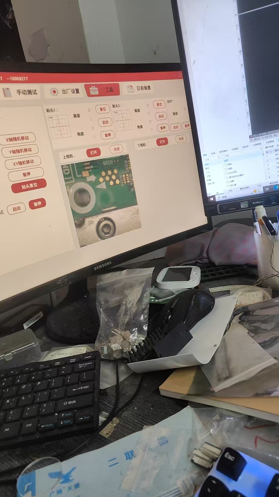
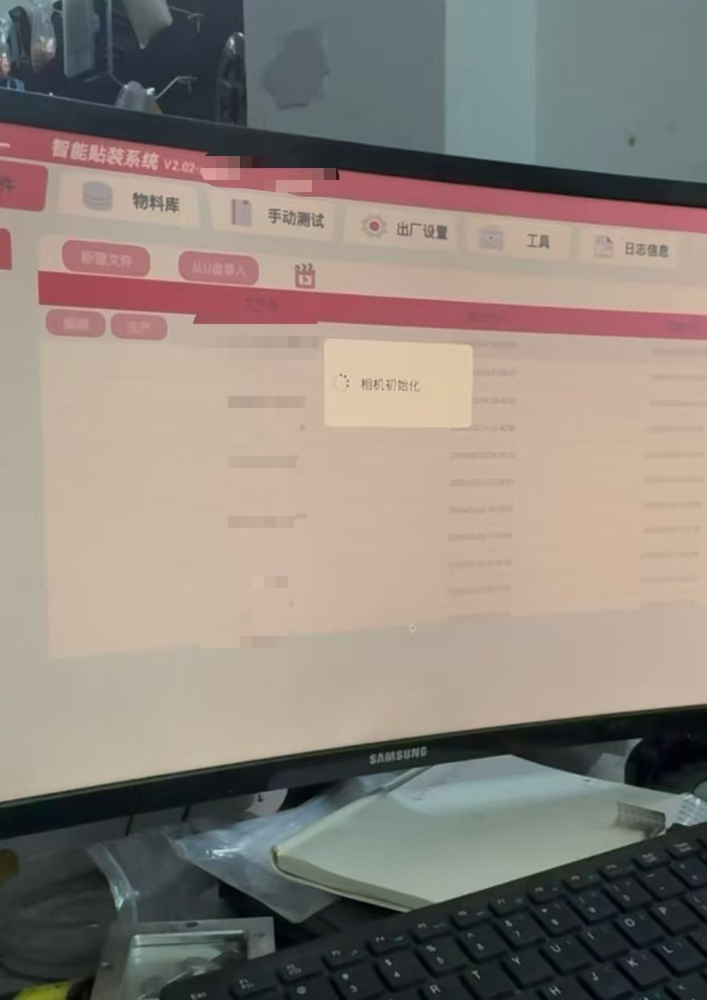
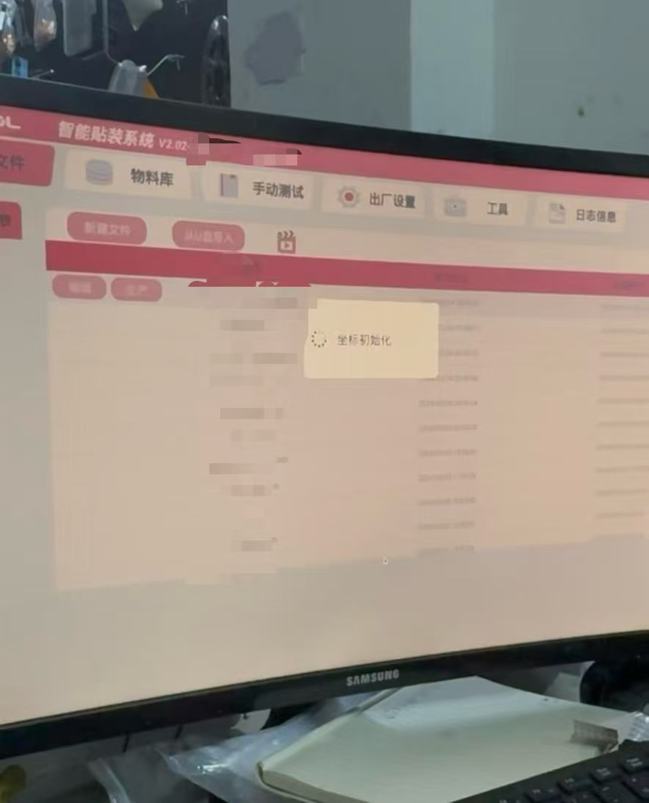

# Createstar E1 Infinite Camera Initialization Recovery

[中文说明在下方](#创思达-e1-贴片机无限相机初始化修复)

## Summary

After an unexpected power loss during production, E1 could remain in an endless camera-initialization loop and could not enter the normal interface. As a temporary diagnostic workaround, the application was launched repeatedly; after one stalled window was closed with `Alt+F4`, `Manual Test` was clicked repeatedly and `Coordinate Initialization` was clicked quickly before the next window entered initialization. This permitted access to the system for investigation; it was not the repair itself.

Once inside E1, the upper camera worked while the lower-camera area was blank. The immediate cause was a stale device mapping in E1's SQLite configuration database:

```text
Ucam = /dev/video2    # opened successfully
Dcam = CN40           # could not be opened on this system
```

The operating system still detected and streamed both USB UVC cameras at `/dev/video0` and `/dev/video2`. Updating `Dcam` to `/dev/video0` restored the lower camera.



## Observed Symptoms

1. The failure appeared immediately after an unexpected power loss while the machine was working.
2. Using the temporary workaround, E1 could be entered, but the lower camera stayed blank.
3. Reversing the two USB camera connections changed which physical camera appeared in the working UI position.
4. Camera cables were disassembled and continuity-tested; both were verified good.





## Investigation

### 1. Hardware and driver checks

Linux detected two HK 5M CAM USB devices through `uvcvideo`. V4L2 inspection showed that `/dev/video0` and `/dev/video2` were the actual video-capture nodes; `/dev/video1` and `/dev/video3` were metadata nodes.

Both capture nodes reported `Video Capture`, `Streaming`, and `Camera 1: ok`. Independent V4L2 stream tests succeeded for both cameras. This ruled out a failed camera module, a disconnected camera cable, and a missing UVC driver.

### 2. E1 startup log

Once the separate feeder-network issue was corrected, the current E1 log showed:

```text
init camera[/dev/video2] success!
init camera[CN40] fail, device can not open!
```

This proved that the application could open one V4L2 device but did not try `/dev/video0` for the second camera.

### 3. E1 configuration database

The relevant E1 configuration file is:

```text
/opt/easy/AppMain/bin/setting.db
```

The database contained the following effective mapping:

```text
PlacementHead / Ucam / DeviceName = /dev/video2
Platform      / Dcam / DeviceName = CN40
```

`CN40` was not a usable V4L2 device name in the recovered system. The operating system exposed the second camera as `/dev/video0` instead.

## Root Cause and Trigger

**Confirmed direct cause:** E1's `Dcam` device mapping did not match the current Linux V4L2 device.

**Most likely trigger:** the unexpected power loss exposed a stale or rolled-back E1 setting. The SQLite database remained readable, so this record does not claim proven database corruption. The power interruption is a plausible trigger, not conclusive proof of the exact write that changed the value.

The USB-swap observation is consistent with the diagnosis: the `Ucam` slot was fixed to `/dev/video2`, so whichever physical camera occupied that node appeared in the working UI. The `Dcam` slot remained unavailable because it still targeted `CN40`.

## Repair

> Stop/exit E1 before editing its database. Back up the database first. Use this only after confirming that `/dev/video0` is the working second capture device on the affected machine.

```bash
sudo cp -p /opt/easy/AppMain/bin/setting.db \
  /opt/easy/AppMain/bin/setting.db.bak
```

```bash
sudo sqlite3 /opt/easy/AppMain/bin/setting.db \
  "UPDATE Platform SET DeviceName='/dev/video0' WHERE Name='Dcam';"
```

Verify the mapping:

```bash
sudo sqlite3 /opt/easy/AppMain/bin/setting.db \
  "SELECT Name,DeviceName FROM Platform WHERE Name IN ('Ucam','Dcam');"
```

Expected result:

```text
Ucam|/dev/video2
Dcam|/dev/video0
```

Restart E1. A successful repair should produce two successful camera initialization entries, one for `/dev/video2` and one for `/dev/video0`.

## Separate Feeder-Network Issue

The same recovery also exposed a separate E1 feeder-network configuration issue. E1 initially reported a failed local bind and socket initialization. After the Raspberry Pi's wired machine-network address was restored and the feeder endpoint became reachable, the log changed to a successful bind and connected socket state.

Keep the wired interface for the machine/feeder subnet and Wi-Fi for remote SSH and ordinary web access. Do not publish real IP addresses, SSH details, passwords, serial numbers, customer data, or machine-specific production files.

---

# 创思达 E1 贴片机无限相机初始化修复

## 摘要

设备在工作中突然断电后重新启动，E1 可能无限停留在“相机初始化”阶段，无法正常进入系统。为进入系统排查，曾采用临时绕过方式：反复启动软件，先用 `Alt+F4` 关闭一个卡住的窗口，再趁下一个窗口准备初始化前，连续点击“手动测试”，然后快速点击“坐标初始化”。该操作仅用于进入系统进行排查，并非正式修复。

进入系统后，上相机正常显示，下相机区域空白。直接原因是 E1 的 SQLite 配置数据库中保存了错误或过期的下相机设备映射：

```text
Ucam = /dev/video2    # 能正常打开
Dcam = CN40           # 当前系统无法打开
```

Linux 仍能正常识别并采集两只 USB UVC 相机，实际视频设备为 `/dev/video0` 和 `/dev/video2`。将 `Dcam` 修改为 `/dev/video0` 后，下相机恢复。


## 故障现象

1. 机器工作中突然断电，重新开机后故障出现；
2. 通过临时绕过可进入 E1 系统，但下相机一直空白；
3. 交换两只相机的 USB 接口后，能显示的物理相机随 USB 设备位置变化；
4. 已拆机并测量相机线，线路导通正常。


## 调查过程

### 1. 排除相机、线缆与 UVC 驱动

系统通过 `uvcvideo` 识别到两只 HK 5M CAM。V4L2 检查显示：

```text
/dev/video0  实际视频采集节点
/dev/video2  实际视频采集节点
/dev/video1  元数据节点，不用于显示图像
/dev/video3  元数据节点，不用于显示图像
```

`/dev/video0` 与 `/dev/video2` 都具有 `Video Capture`、`Streaming` 和 `Camera 1: ok`，并且两路独立流测试均成功。因此可排除相机模块、相机线与 UVC 驱动故障。

### 2. E1 启动日志

修复独立的料站网络问题后，E1 当前日志显示：

```text
init camera[/dev/video2] success!
init camera[CN40] fail, device can not open!
```

这证明 E1 能打开一路 V4L2 相机，但第二路没有尝试 `/dev/video0`，而是尝试打开 `CN40`。

### 3. 检查 E1 配置数据库

E1 的配置数据库为：

```text
/opt/easy/AppMain/bin/setting.db
```

实际映射为：

```text
PlacementHead / Ucam / DeviceName = /dev/video2
Platform      / Dcam / DeviceName = CN40
```

当前恢复后的系统中，`CN40` 不是可用的 V4L2 设备名；第二只相机实际位于 `/dev/video0`。

## 根因与触发因素

**已确认的直接原因：** E1 中 `Dcam` 的设备映射与当前 Linux V4L2 设备不匹配。

**最可能的触发因素：** 工作中突然断电使旧配置、未正常保存的配置或回退后的配置重新生效。`setting.db` 仍然可以读取，因此本文不把它定性为已证实的数据库结构损坏；断电是高度相关的触发因素，但不是已被完全证明的唯一写入原因。

交换 USB 后画面随之变化，也与该结论相符：`Ucam` 固定使用 `/dev/video2`，哪只物理相机位于该节点就显示在哪个可用画面中；`Dcam` 则始终因仍指向 `CN40` 而不可用。

## 修复方法

> 修改前请退出 E1，并先备份数据库。仅在已确认该机器第二路正常视频设备是 `/dev/video0` 时使用。

```bash
sudo cp -p /opt/easy/AppMain/bin/setting.db \
  /opt/easy/AppMain/bin/setting.db.bak
```

```bash
sudo sqlite3 /opt/easy/AppMain/bin/setting.db \
  "UPDATE Platform SET DeviceName='/dev/video0' WHERE Name='Dcam';"
```

验证：

```bash
sudo sqlite3 /opt/easy/AppMain/bin/setting.db \
  "SELECT Name,DeviceName FROM Platform WHERE Name IN ('Ucam','Dcam');"
```

预期结果：

```text
Ucam|/dev/video2
Dcam|/dev/video0
```

重新启动 E1 后，应看到 `/dev/video2` 与 `/dev/video0` 两路相机初始化成功。

## 独立的料站网络问题

恢复过程中还发现 E1 有单独的料站网络配置问题：最初日志显示本地绑定和 Socket 初始化失败；恢复树莓派有线机台网络地址、确认料站可达后，日志变为本地绑定成功和 Socket 已连接。

建议让有线网卡专用于机台/料站网段，Wi-Fi 专用于远程 SSH 与普通网页访问。公开文章时不要写入真实 IP、SSH 资料、密码、相机序列号、客户资料或生产文件。

