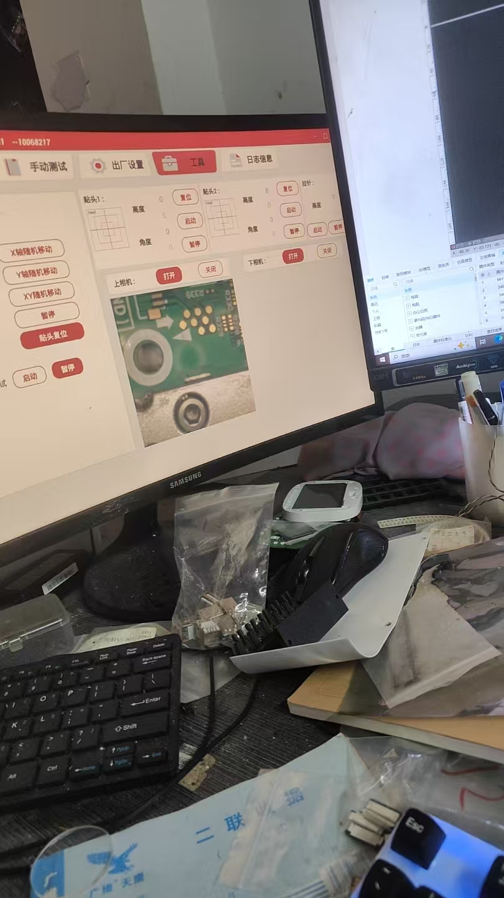
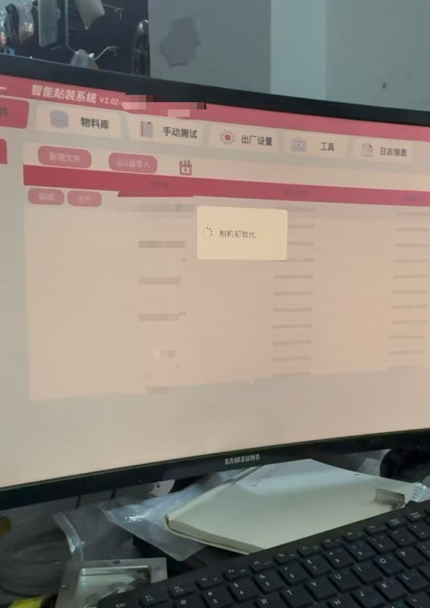
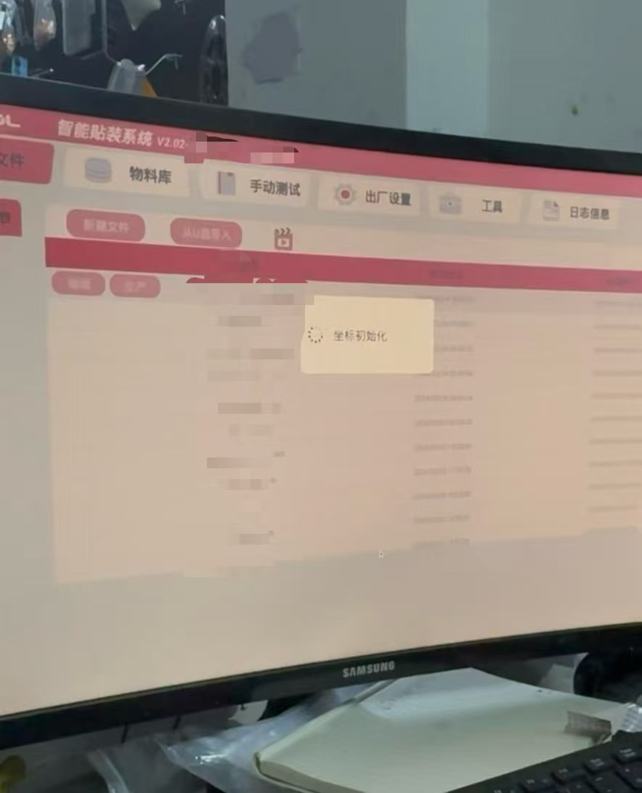

# 创思达 E1 贴片机无限相机初始化修复

## 一、故障出现方式

机器工作中发生空气开关跳闸，导致整机突然断电。

重新启动后，E1 无限停留在“相机初始化”阶段，无法正常进入系统。为进入系统排查，曾采用临时绕过方式：反复启动软件，先用 `Alt+F4` 关闭一个卡住的窗口，再趁下一个窗口准备初始化前，连续点击“手动测试”，然后快速点击“坐标初始化”。该操作仅用于进入系统进行排查，并非正式修复。

进入系统后，上相机显示正常，下相机区域空白。交换两只相机的 USB 接口后，能够显示的物理相机会跟随 USB 位置变化。



已完成以下硬件排除：

- 拆机测试两根相机线，线路导通正常；
- 两只相机均能被树莓派识别；
- 两只相机均可通过 V4L2 单独采集画面。





## 二、V4L2 检查结果：硬件与驱动正常

系统中的两只 HK 5M CAM 均由 `uvcvideo` 驱动识别。实际视频采集节点为：

```text
/dev/video0
/dev/video2
```

`/dev/video1` 和 `/dev/video3` 为元数据节点，不用于图像采集。对 `/dev/video0` 与 `/dev/video2` 分别执行 V4L2 查询和流测试后，均确认具备 `Video Capture`、`Streaming`、`Camera 1: ok`，且都能输出视频帧。

因此，故障不属于相机模块、线缆或 UVC 驱动问题。

## 三、E1 日志给出的关键线索

料站网络恢复后，E1 的当前日志显示：

```text
init camera[/dev/video2] success!
init camera[CN40] fail, device can not open!
```

这说明 E1 成功打开了一路 `/dev/video2`，但第二路没有打开 `/dev/video0`，而是尝试打开 `CN40`。

## 四、根因：`setting.db` 中下相机映射失配

E1 的配置数据库位置：

```text
/opt/easy/AppMain/bin/setting.db
```

查询后得到：

```text
Ucam = /dev/video2
Dcam = CN40
```

`Ucam` 与实际系统设备一致，因此正常；`Dcam` 指向的 `CN40` 在当前恢复后的系统中不是可打开的 V4L2 设备，导致下相机初始化失败。

机器工作时发生空气开关跳闸导致整机突然断电，是最可能的触发因素：它可能使旧配置、未正常保存的配置或回退后的配置再次生效。数据库仍可以读取，因此不能把它直接定性为已证实的 SQLite 结构损坏。已确认的是当前配置与当前设备不匹配。

## 五、修复方法

先退出 E1，并备份数据库：

```bash
sudo cp -p /opt/easy/AppMain/bin/setting.db \
  /opt/easy/AppMain/bin/setting.db.bak
```

将下相机改成已经验证可用的第二路视频设备：

```bash
sudo sqlite3 /opt/easy/AppMain/bin/setting.db \
  "UPDATE Platform SET DeviceName='/dev/video0' WHERE Name='Dcam';"
```

验证：

```bash
sudo sqlite3 /opt/easy/AppMain/bin/setting.db \
  "SELECT Name,DeviceName FROM Platform WHERE Name IN ('Ucam','Dcam');"
```

预期：

```text
Ucam|/dev/video2
Dcam|/dev/video0
```

重新打开 E1 后，日志应出现两路相机初始化成功的记录。

## 六、补充：料站网络是独立问题

排查过程中还出现过料站 Socket 本地绑定失败。这是有线机台网络没有正确恢复导致的独立问题，不是相机故障。建议：

- 有线网卡：只连接机台/料站网段；
- Wi-Fi：只用于远程 SSH 与网页访问；
- 公开记录时不要写入真实 IP、账号、密码或客户生产资料。

